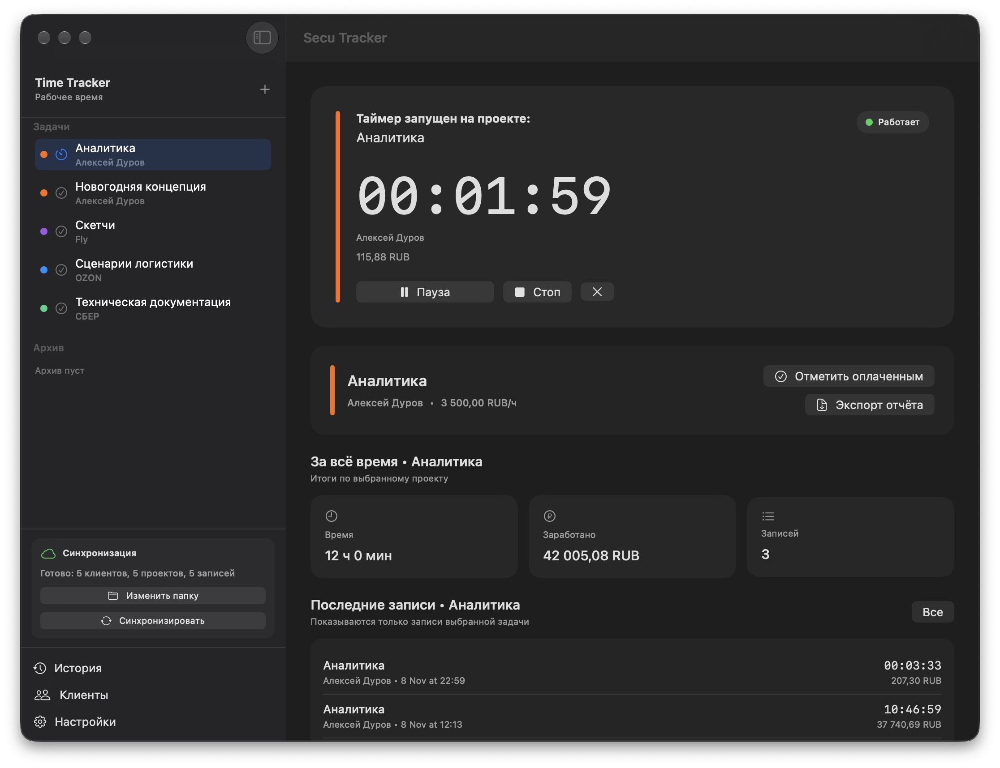
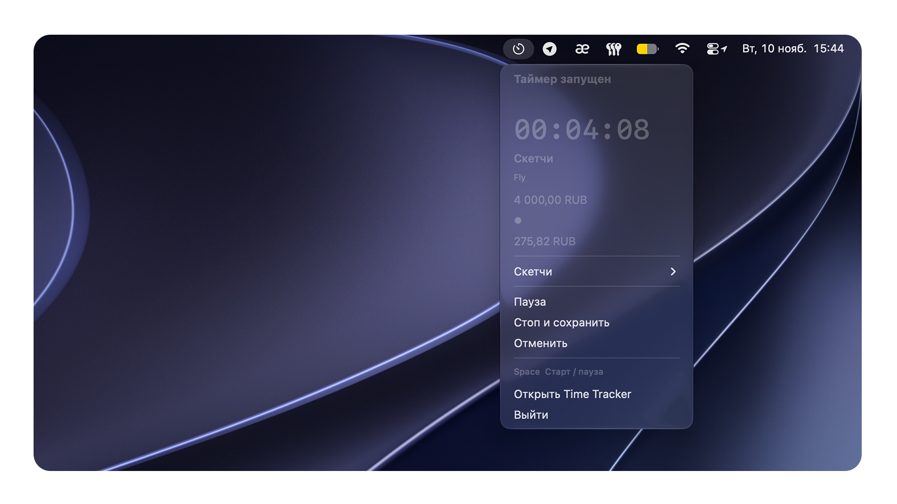
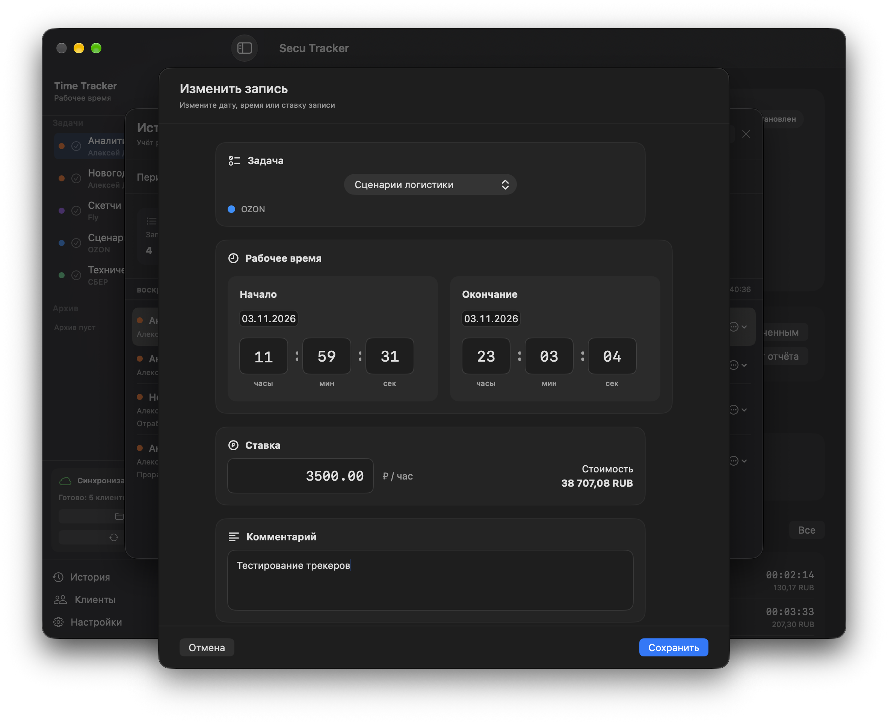
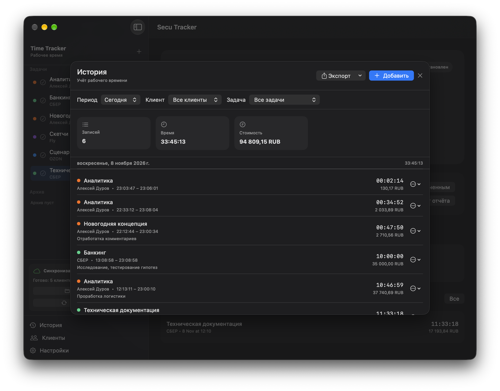
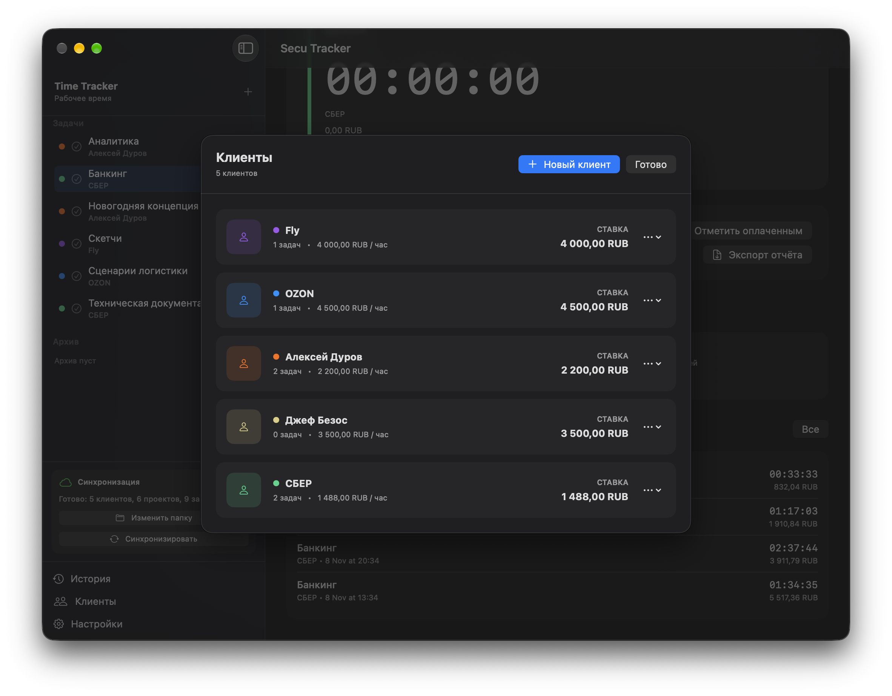
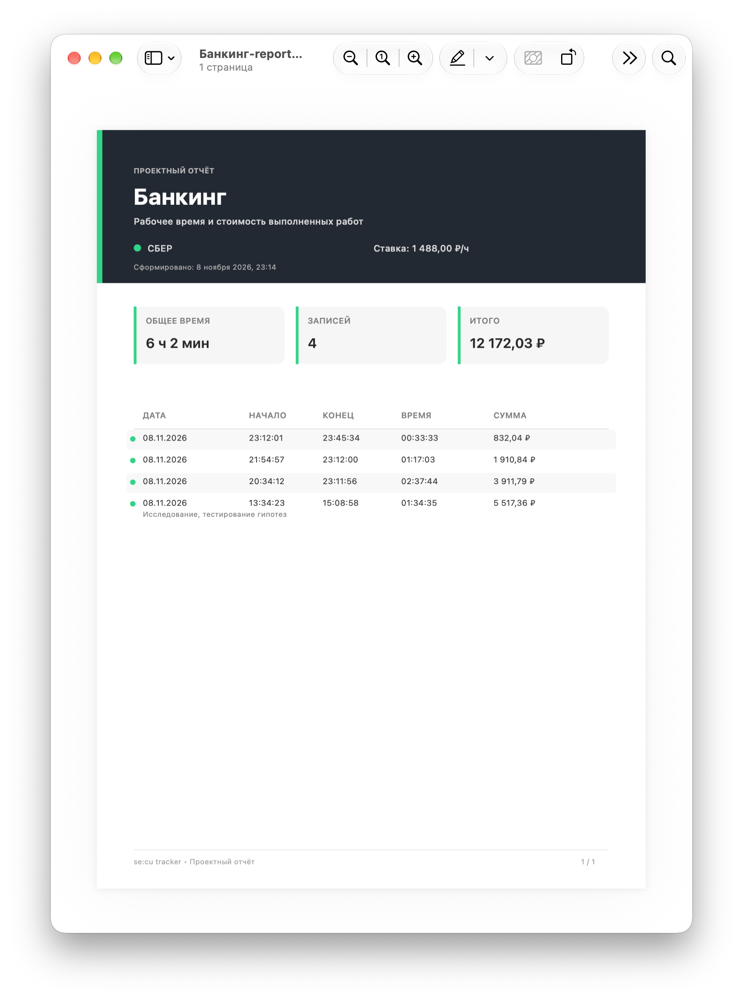

**se$\color{red}{:}$cu tracker**

**A lightweight time tracking app for macOS with a Russian-language interface.**

Secu Tracker helps freelancers and creative professionals track working hours, organize clients and projects, and calculate their earnings.

## Screenshots

### Main Window

### Menu Bar Timer

### Manual Time Entry

### Work History

### Clients & Projects

### Reports

## Download

[Download the latest version](../../releases/latest)

## Features

- **Time Tracking** — track time spent on different tasks and projects.
- **Client Management** — organize clients and their projects in one place.
- **Flexible Hourly Rates** — set default rates for clients and custom rates for individual tasks.
- **Work History** — view, edit, and manage time entries.
- **Reports & Export** — export work history to CSV and PDF.
- **Menu Bar Access** — access time tracking tools directly from the macOS menu bar.
- **Data Synchronization** — synchronize work data between devices.

## Language

The application interface is currently available in **Russian only**.

## Requirements

- macOS
- Mac with Apple Silicon or Intel processor, depending on the supported build.

## Installation

Download the latest available version from the [Releases](../../releases) section.

## Privacy

Secu Tracker is designed for local use and user-controlled data storage.

- No account required.
- No subscription.
- Your work data stays under your control.

## Technology

Built with:
- Swift
- SwiftUI
- SwiftData

Using native Apple technologies for macOS.

## License

All rights reserved.

The source code is available for viewing. Copying, modifying, distributing, or using the code in other projects is not permitted without prior permission from the author.
